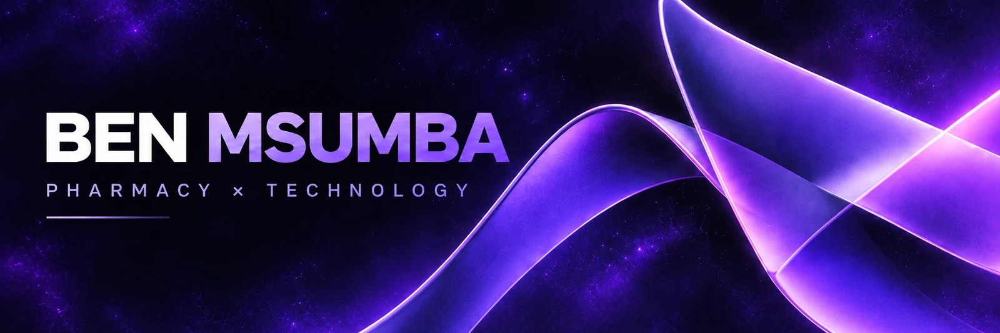
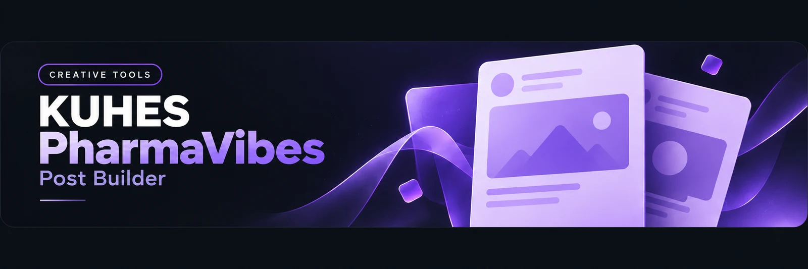

I'm **Ben Msumba**, a **Bachelor of Pharmacy (Honours)** student at **Kamuzu University of Health Sciences (KUHeS)**, exploring health technology and building useful web tools.

[Portfolio](https://www.benmsumba.me/) · [LinkedIn](https://www.linkedin.com/in/benmsumba/) · [Repositories](https://github.com/Benmsumba?tab=repositories)

## Selected work

### [Explore the Post Builder](https://github.com/Benmsumba/kuhespharmavibes_post_builder)

Upload a photo, edit your message, switch between Facebook and TikTok formats, and export your branded design.

**React · Vite · JavaScript**

### [Explore my portfolio](https://github.com/Benmsumba/Portfolio)

My introduction to pharmacy, education, and health technology, with an interactive molecular scene and reduced-motion support.

**React · Three.js · Vite · CSS**

---

Interested in pharmacy, health technology, or building useful things for the web? **[Let's connect on LinkedIn](https://www.linkedin.com/in/benmsumba/).**

Learning at the intersection of pharmacy and technology.
