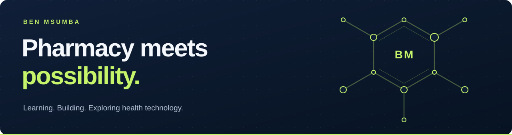

# Ben Msumba

**Pharmacy student · Health technology enthusiast · Web builder**

I'm pursuing a **Bachelor of Pharmacy (Honours)** at **Kamuzu University of Health Sciences (KUHeS)**. I'm interested in how medicines work and how thoughtful technology can help improve healthcare.

Here, I share web projects that bring together learning, creativity, and practical tools.

[Connect on LinkedIn](https://www.linkedin.com/in/benmsumba/) · [Explore my repositories](https://github.com/Benmsumba?tab=repositories)

## Selected work

### [KUHES PharmaVibes Post Builder](https://github.com/Benmsumba/kuhespharmavibes_post_builder)

A branded social post builder: upload a photo, edit your message, switch between Facebook and TikTok formats, and export the finished design.

**Built with:** React · Vite · JavaScript

### [Personal Portfolio](https://github.com/Benmsumba/Portfolio)

My introduction to pharmacy, education, and health technology, presented through a navy-and-lime interface with an interactive molecular scene and reduced-motion support.

**Built with:** React · Three.js · Vite · CSS

## What I'm exploring

- **Pharmacy:** understanding medicines, their mechanisms, and their role in treating disease.
- **Health technology:** learning where digital tools could help address healthcare challenges.
- **Web development:** turning ideas into useful, approachable interfaces.

## Let's connect

Interested in pharmacy, health technology, or building useful things for the web? [Find me on LinkedIn](https://www.linkedin.com/in/benmsumba/).

---

Learning at the intersection of pharmacy and technology.
